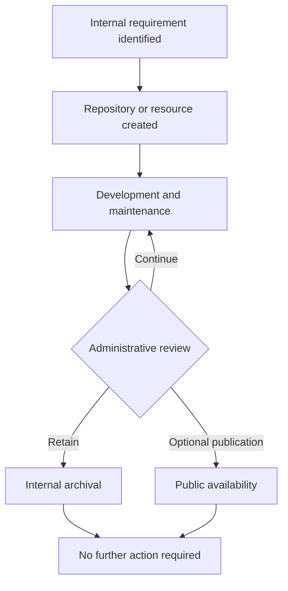

# ORGANIZATION OPERATIONS & INFORMATION REGISTER

### Public-facing administrative documentation

  

**ORG-GEN-001 · REVISION 2.0 · INFORMATIONAL USE ONLY**

*This page contains general administrative information. It is not a product announcement.*

---

> [!IMPORTANT]
> This organization primarily maintains private repositories. The absence of publicly available code does not indicate an absence of internal activity.

## Document control

| Field | Recorded value |
|:--|:--|
| Document identifier | `ORG-GEN-001` |
| Document category | General organizational information |
| Visibility classification | Public |
| Operational scope | Internal development and repository management |
| Public support | Not provided |
| Publication schedule | Not established |
| Review interval | As required |
| Document status | Active |

## Contents

01. [Introduction](#1-introduction)
02. [Organizational Purpose](#2-organizational-purpose)
03. [Scope of Activities](#3-scope-of-activities)
04. [Repository Administration](#4-repository-administration)
05. [Repository Visibility](#5-repository-visibility)
06. [Access Management](#6-access-management)
07. [Development Environment](#7-development-environment)
08. [Project Lifecycle](#8-project-lifecycle)
09. [Documentation](#9-documentation)
10. [Maintenance Procedures](#10-maintenance-procedures)
11. [Testing and Experimental Resources](#11-testing-and-experimental-resources)
12. [Version Control and Historical Records](#12-version-control-and-historical-records)
13. [Release Management](#13-release-management)
14. [Infrastructure and Supporting Resources](#14-infrastructure-and-supporting-resources)
15. [Security and Confidentiality](#15-security-and-confidentiality)
16. [External Contributions](#16-external-contributions)
17. [Public Communication](#17-public-communication)
18. [Support and Assistance](#18-support-and-assistance)
19. [Intellectual Property and Licensing](#19-intellectual-property-and-licensing)
20. [Data Retention and Archival](#20-data-retention-and-archival)
21. [Organizational Changes](#21-organizational-changes)
22. [Operational Independence](#22-operational-independence)
23. [Limitations of Public Information](#23-limitations-of-public-information)
24. [Interpretation of Organizational Activity](#24-interpretation-of-organizational-activity)
25. [Administrative Discretion](#25-administrative-discretion)
26. [Information Accuracy](#26-information-accuracy)
27. [Availability of Resources](#27-availability-of-resources)
28. [Future Development](#28-future-development)
29. [General Disclaimer](#29-general-disclaimer)
30. [Final Administrative Statement](#30-final-administrative-statement)

---

## Administrative process overview

> [!NOTE]
> The diagram is illustrative. It does not establish a mandatory workflow, procedural standard, or commitment to publication.

---

## 1. Introduction

This document establishes the general informational framework for the organization and describes its administrative purpose, operating assumptions, and public-facing limitations.

The practices described in this section are general in nature and may be applied differently depending on the relevant repository, resource, or administrative circumstance. The inclusion of this description should not be interpreted as evidence that any specific project, service, or procedure is currently active.

Where a particular arrangement is not documented publicly, no assumption should be made concerning its existence, completeness, implementation status, or future availability. Internal decisions may be revised as requirements change, and corresponding public updates are not necessarily issued.

---

## 2. Organizational Purpose

The organization provides a centralized environment for independent development, internal resource storage, and separation of private work from publicly distributed materials.

The practices described in this section are general in nature and may be applied differently depending on the relevant repository, resource, or administrative circumstance. The inclusion of this description should not be interpreted as evidence that any specific project, service, or procedure is currently active.

Where a particular arrangement is not documented publicly, no assumption should be made concerning its existence, completeness, implementation status, or future availability. Internal decisions may be revised as requirements change, and corresponding public updates are not necessarily issued.

---

## 3. Scope of Activities

Activities may include software development, documentation, infrastructure configuration, automation, testing, experimentation, technical evaluation, and archival operations.

The practices described in this section are general in nature and may be applied differently depending on the relevant repository, resource, or administrative circumstance. The inclusion of this description should not be interpreted as evidence that any specific project, service, or procedure is currently active.

Where a particular arrangement is not documented publicly, no assumption should be made concerning its existence, completeness, implementation status, or future availability. Internal decisions may be revised as requirements change, and corresponding public updates are not necessarily issued.

---

## 4. Repository Administration

Repositories are created, configured, renamed, transferred, archived, or removed in accordance with individual project requirements and administrative preferences.

The practices described in this section are general in nature and may be applied differently depending on the relevant repository, resource, or administrative circumstance. The inclusion of this description should not be interpreted as evidence that any specific project, service, or procedure is currently active.

Where a particular arrangement is not documented publicly, no assumption should be made concerning its existence, completeness, implementation status, or future availability. Internal decisions may be revised as requirements change, and corresponding public updates are not necessarily issued.

---

## 5. Repository Visibility

Repository visibility is determined independently. Private visibility is the default operating assumption, and no publication schedule is implied.

The practices described in this section are general in nature and may be applied differently depending on the relevant repository, resource, or administrative circumstance. The inclusion of this description should not be interpreted as evidence that any specific project, service, or procedure is currently active.

Where a particular arrangement is not documented publicly, no assumption should be made concerning its existence, completeness, implementation status, or future availability. Internal decisions may be revised as requirements change, and corresponding public updates are not necessarily issued.

<strong>Supplementary administrative clarification</strong>

This clarification is retained for completeness. It does not introduce an additional service, permission, obligation, deliverable, schedule, or entitlement. The applicable internal arrangements, if any, remain subject to administrative review and may be changed without external notification.

> [!CAUTION]
> Public visibility of this document must not be interpreted as authorization to access private repositories or internal resources.

---

## 6. Access Management

Access to restricted resources is limited to authorized accounts. Permissions may differ between repositories and may be changed without public notification.

The practices described in this section are general in nature and may be applied differently depending on the relevant repository, resource, or administrative circumstance. The inclusion of this description should not be interpreted as evidence that any specific project, service, or procedure is currently active.

Where a particular arrangement is not documented publicly, no assumption should be made concerning its existence, completeness, implementation status, or future availability. Internal decisions may be revised as requirements change, and corresponding public updates are not necessarily issued.

---

## 7. Development Environment

Development tools, operating systems, frameworks, and supporting technologies are selected according to individual technical requirements rather than an organization-wide standard.

The practices described in this section are general in nature and may be applied differently depending on the relevant repository, resource, or administrative circumstance. The inclusion of this description should not be interpreted as evidence that any specific project, service, or procedure is currently active.

Where a particular arrangement is not documented publicly, no assumption should be made concerning its existence, completeness, implementation status, or future availability. Internal decisions may be revised as requirements change, and corresponding public updates are not necessarily issued.

---

## 8. Project Lifecycle

Projects may move between planning, experimentation, implementation, testing, maintenance, suspension, and archival without a prescribed sequence.

The practices described in this section are general in nature and may be applied differently depending on the relevant repository, resource, or administrative circumstance. The inclusion of this description should not be interpreted as evidence that any specific project, service, or procedure is currently active.

Where a particular arrangement is not documented publicly, no assumption should be made concerning its existence, completeness, implementation status, or future availability. Internal decisions may be revised as requirements change, and corresponding public updates are not necessarily issued.

---

## 9. Documentation

Documentation may be maintained for internal reference. Its availability, completeness, structure, and update frequency are not guaranteed.

The practices described in this section are general in nature and may be applied differently depending on the relevant repository, resource, or administrative circumstance. The inclusion of this description should not be interpreted as evidence that any specific project, service, or procedure is currently active.

Where a particular arrangement is not documented publicly, no assumption should be made concerning its existence, completeness, implementation status, or future availability. Internal decisions may be revised as requirements change, and corresponding public updates are not necessarily issued.

---

## 10. Maintenance Procedures

Maintenance is performed when required. The absence of recent public updates does not establish inactivity or abandonment.

The practices described in this section are general in nature and may be applied differently depending on the relevant repository, resource, or administrative circumstance. The inclusion of this description should not be interpreted as evidence that any specific project, service, or procedure is currently active.

Where a particular arrangement is not documented publicly, no assumption should be made concerning its existence, completeness, implementation status, or future availability. Internal decisions may be revised as requirements change, and corresponding public updates are not necessarily issued.

<strong>Supplementary administrative clarification</strong>

This clarification is retained for completeness. It does not introduce an additional service, permission, obligation, deliverable, schedule, or entitlement. The applicable internal arrangements, if any, remain subject to administrative review and may be changed without external notification.

---

## 11. Testing and Experimental Resources

Experimental materials may be incomplete, unstable, temporary, or unsuitable for general distribution. No production-readiness claim is made.

The practices described in this section are general in nature and may be applied differently depending on the relevant repository, resource, or administrative circumstance. The inclusion of this description should not be interpreted as evidence that any specific project, service, or procedure is currently active.

Where a particular arrangement is not documented publicly, no assumption should be made concerning its existence, completeness, implementation status, or future availability. Internal decisions may be revised as requirements change, and corresponding public updates are not necessarily issued.

---

## 12. Version Control and Historical Records

Commit histories, branches, tags, and other metadata are retained primarily for internal development and administrative reference.

The practices described in this section are general in nature and may be applied differently depending on the relevant repository, resource, or administrative circumstance. The inclusion of this description should not be interpreted as evidence that any specific project, service, or procedure is currently active.

Where a particular arrangement is not documented publicly, no assumption should be made concerning its existence, completeness, implementation status, or future availability. Internal decisions may be revised as requirements change, and corresponding public updates are not necessarily issued.

---

## 13. Release Management

No general release schedule exists. Version identifiers, when present, may be used exclusively for internal tracking.

The practices described in this section are general in nature and may be applied differently depending on the relevant repository, resource, or administrative circumstance. The inclusion of this description should not be interpreted as evidence that any specific project, service, or procedure is currently active.

Where a particular arrangement is not documented publicly, no assumption should be made concerning its existence, completeness, implementation status, or future availability. Internal decisions may be revised as requirements change, and corresponding public updates are not necessarily issued.

---

## 14. Infrastructure and Supporting Resources

Infrastructure-related repositories may contain configuration templates, workflow definitions, scripts, and other resources without implying public service availability.

The practices described in this section are general in nature and may be applied differently depending on the relevant repository, resource, or administrative circumstance. The inclusion of this description should not be interpreted as evidence that any specific project, service, or procedure is currently active.

Where a particular arrangement is not documented publicly, no assumption should be made concerning its existence, completeness, implementation status, or future availability. Internal decisions may be revised as requirements change, and corresponding public updates are not necessarily issued.

---

## 15. Security and Confidentiality

Internal security arrangements and restricted repository contents are not described in this public profile. Access remains subject to applicable platform controls.

The practices described in this section are general in nature and may be applied differently depending on the relevant repository, resource, or administrative circumstance. The inclusion of this description should not be interpreted as evidence that any specific project, service, or procedure is currently active.

Where a particular arrangement is not documented publicly, no assumption should be made concerning its existence, completeness, implementation status, or future availability. Internal decisions may be revised as requirements change, and corresponding public updates are not necessarily issued.

<strong>Supplementary administrative clarification</strong>

This clarification is retained for completeness. It does not introduce an additional service, permission, obligation, deliverable, schedule, or entitlement. The applicable internal arrangements, if any, remain subject to administrative review and may be changed without external notification.

> [!CAUTION]
> Public visibility of this document must not be interpreted as authorization to access private repositories or internal resources.

---

## 16. External Contributions

The organization does not maintain an open contribution program. Unsolicited proposals and access requests are not guaranteed consideration.

The practices described in this section are general in nature and may be applied differently depending on the relevant repository, resource, or administrative circumstance. The inclusion of this description should not be interpreted as evidence that any specific project, service, or procedure is currently active.

Where a particular arrangement is not documented publicly, no assumption should be made concerning its existence, completeness, implementation status, or future availability. Internal decisions may be revised as requirements change, and corresponding public updates are not necessarily issued.

---

## 17. Public Communication

Public announcements, activity reports, and development summaries are optional and may be omitted for indefinite periods.

The practices described in this section are general in nature and may be applied differently depending on the relevant repository, resource, or administrative circumstance. The inclusion of this description should not be interpreted as evidence that any specific project, service, or procedure is currently active.

Where a particular arrangement is not documented publicly, no assumption should be made concerning its existence, completeness, implementation status, or future availability. Internal decisions may be revised as requirements change, and corresponding public updates are not necessarily issued.

---

## 18. Support and Assistance

No general technical support service is offered. Publicly visible materials, if any, may be provided without ongoing assistance.

The practices described in this section are general in nature and may be applied differently depending on the relevant repository, resource, or administrative circumstance. The inclusion of this description should not be interpreted as evidence that any specific project, service, or procedure is currently active.

Where a particular arrangement is not documented publicly, no assumption should be made concerning its existence, completeness, implementation status, or future availability. Internal decisions may be revised as requirements change, and corresponding public updates are not necessarily issued.

---

## 19. Intellectual Property and Licensing

Licensing is determined at the individual repository level. The existence of a public profile does not grant rights to restricted materials.

The practices described in this section are general in nature and may be applied differently depending on the relevant repository, resource, or administrative circumstance. The inclusion of this description should not be interpreted as evidence that any specific project, service, or procedure is currently active.

Where a particular arrangement is not documented publicly, no assumption should be made concerning its existence, completeness, implementation status, or future availability. Internal decisions may be revised as requirements change, and corresponding public updates are not necessarily issued.

---

## 20. Data Retention and Archival

Resources may be retained, archived, restored, reorganized, or deleted according to administrative needs. No universal retention period applies.

The practices described in this section are general in nature and may be applied differently depending on the relevant repository, resource, or administrative circumstance. The inclusion of this description should not be interpreted as evidence that any specific project, service, or procedure is currently active.

Where a particular arrangement is not documented publicly, no assumption should be made concerning its existence, completeness, implementation status, or future availability. Internal decisions may be revised as requirements change, and corresponding public updates are not necessarily issued.

<strong>Supplementary administrative clarification</strong>

This clarification is retained for completeness. It does not introduce an additional service, permission, obligation, deliverable, schedule, or entitlement. The applicable internal arrangements, if any, remain subject to administrative review and may be changed without external notification.

---

## 21. Organizational Changes

Administrative structures, naming conventions, repository arrangements, and procedures may change without a public consultation process.

The practices described in this section are general in nature and may be applied differently depending on the relevant repository, resource, or administrative circumstance. The inclusion of this description should not be interpreted as evidence that any specific project, service, or procedure is currently active.

Where a particular arrangement is not documented publicly, no assumption should be made concerning its existence, completeness, implementation status, or future availability. Internal decisions may be revised as requirements change, and corresponding public updates are not necessarily issued.

---

## 22. Operational Independence

This organization is independently administered and does not imply affiliation with any commercial, educational, or governmental institution.

The practices described in this section are general in nature and may be applied differently depending on the relevant repository, resource, or administrative circumstance. The inclusion of this description should not be interpreted as evidence that any specific project, service, or procedure is currently active.

Where a particular arrangement is not documented publicly, no assumption should be made concerning its existence, completeness, implementation status, or future availability. Internal decisions may be revised as requirements change, and corresponding public updates are not necessarily issued.

---

## 23. Limitations of Public Information

The information presented here is intentionally general and should not be treated as a complete inventory of internal projects or operational arrangements.

The practices described in this section are general in nature and may be applied differently depending on the relevant repository, resource, or administrative circumstance. The inclusion of this description should not be interpreted as evidence that any specific project, service, or procedure is currently active.

Where a particular arrangement is not documented publicly, no assumption should be made concerning its existence, completeness, implementation status, or future availability. Internal decisions may be revised as requirements change, and corresponding public updates are not necessarily issued.

---

## 24. Interpretation of Organizational Activity

Publicly observable activity does not necessarily reflect internal activity. A lack of public repositories does not establish a lack of development.

The practices described in this section are general in nature and may be applied differently depending on the relevant repository, resource, or administrative circumstance. The inclusion of this description should not be interpreted as evidence that any specific project, service, or procedure is currently active.

Where a particular arrangement is not documented publicly, no assumption should be made concerning its existence, completeness, implementation status, or future availability. Internal decisions may be revised as requirements change, and corresponding public updates are not necessarily issued.

---

## 25. Administrative Discretion

Administrative decisions concerning visibility, permissions, publication, and maintenance are made according to internal priorities.

The practices described in this section are general in nature and may be applied differently depending on the relevant repository, resource, or administrative circumstance. The inclusion of this description should not be interpreted as evidence that any specific project, service, or procedure is currently active.

Where a particular arrangement is not documented publicly, no assumption should be made concerning its existence, completeness, implementation status, or future availability. Internal decisions may be revised as requirements change, and corresponding public updates are not necessarily issued.

<strong>Supplementary administrative clarification</strong>

This clarification is retained for completeness. It does not introduce an additional service, permission, obligation, deliverable, schedule, or entitlement. The applicable internal arrangements, if any, remain subject to administrative review and may be changed without external notification.

> [!CAUTION]
> Public visibility of this document must not be interpreted as authorization to access private repositories or internal resources.

---

## 26. Information Accuracy

Public descriptions may become outdated as internal procedures evolve. This document is informational rather than an operational specification.

The practices described in this section are general in nature and may be applied differently depending on the relevant repository, resource, or administrative circumstance. The inclusion of this description should not be interpreted as evidence that any specific project, service, or procedure is currently active.

Where a particular arrangement is not documented publicly, no assumption should be made concerning its existence, completeness, implementation status, or future availability. Internal decisions may be revised as requirements change, and corresponding public updates are not necessarily issued.

---

## 27. Availability of Resources

No minimum level of public resource availability is guaranteed. Public resources may be restricted, transferred, or discontinued.

The practices described in this section are general in nature and may be applied differently depending on the relevant repository, resource, or administrative circumstance. The inclusion of this description should not be interpreted as evidence that any specific project, service, or procedure is currently active.

Where a particular arrangement is not documented publicly, no assumption should be made concerning its existence, completeness, implementation status, or future availability. Internal decisions may be revised as requirements change, and corresponding public updates are not necessarily issued.

---

## 28. Future Development

Future activities depend on technical needs and available resources. No public roadmap, milestone commitment, or publication obligation exists.

The practices described in this section are general in nature and may be applied differently depending on the relevant repository, resource, or administrative circumstance. The inclusion of this description should not be interpreted as evidence that any specific project, service, or procedure is currently active.

Where a particular arrangement is not documented publicly, no assumption should be made concerning its existence, completeness, implementation status, or future availability. Internal decisions may be revised as requirements change, and corresponding public updates are not necessarily issued.

---

## 29. General Disclaimer

This document provides information only and establishes no contractual relationship, warranty, service commitment, or entitlement to access.

The practices described in this section are general in nature and may be applied differently depending on the relevant repository, resource, or administrative circumstance. The inclusion of this description should not be interpreted as evidence that any specific project, service, or procedure is currently active.

Where a particular arrangement is not documented publicly, no assumption should be made concerning its existence, completeness, implementation status, or future availability. Internal decisions may be revised as requirements change, and corresponding public updates are not necessarily issued.

---

## 30. Final Administrative Statement

The organization remains a private workspace for independent technical activities. No additional public information is required or scheduled.

The practices described in this section are general in nature and may be applied differently depending on the relevant repository, resource, or administrative circumstance. The inclusion of this description should not be interpreted as evidence that any specific project, service, or procedure is currently active.

Where a particular arrangement is not documented publicly, no assumption should be made concerning its existence, completeness, implementation status, or future availability. Internal decisions may be revised as requirements change, and corresponding public updates are not necessarily issued.

<strong>Supplementary administrative clarification</strong>

This clarification is retained for completeness. It does not introduce an additional service, permission, obligation, deliverable, schedule, or entitlement. The applicable internal arrangements, if any, remain subject to administrative review and may be changed without external notification.

---

## Appendix A — Public availability matrix

| Resource category | Public availability | Commitment |
|:--|:--:|:--|
| Organization profile | Available | Informational only |
| Internal repositories | Restricted | No public access |
| Development documentation | Not guaranteed | None |
| Release artifacts | Not scheduled | None |
| Technical support | Not offered | None |
| Public roadmap | Not maintained | None |

## Appendix B — Administrative terminology

| Term | Meaning in this document |
|:--|:--|
| **Internal** | Intended for use within the organization |
| **Restricted** | Not generally accessible to external users |
| **Archived** | Retained without a commitment to active maintenance |
| **Public** | Visible without special repository authorization |
| **As required** | Determined by administrative needs rather than a fixed schedule |

<strong>Appendix C — Additional non-binding clarification</strong>

This appendix is provided to reduce ambiguity concerning the absence of public information. It does not supplement or replace repository-specific licensing, applicable platform terms, or internal administrative decisions. No response is requested, and no acknowledgment is necessary.

---

### END OF PUBLIC INFORMATION REGISTER

**NO FURTHER ACTION REQUIRED**

`ORG-GEN-001 / END OF DOCUMENT`

